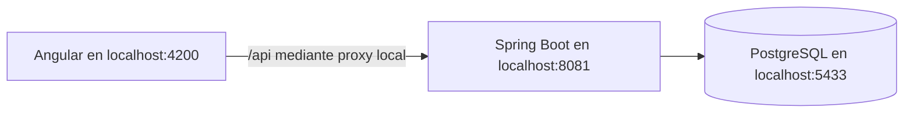

# Arquitectura y alcance

## Usuarios y primer flujo

El encargado registra al cliente y recibe su trabajo. Una orden nueva comienza
pendiente. El cliente debe existir y la descripción es obligatoria.
El correo es opcional; si se informa, debe tener formato válido.

## Datos

Customer: id, name, phone, email, createdAt.
WorkOrder: id, customerId, description, status, createdAt.
OrderHistory: id, orderId, fromStatus, toStatus, changedAt.
Relación: un cliente tiene múltiples órdenes. Clave foránea en PostgreSQL.
Flyway crea el esquema; Hibernate lo valida y no lo modifica automáticamente.

## Decisiones

- Monolito con API REST para evitar infraestructura innecesaria.
- DTO de entrada validado y DTO de salida; no exponer las entidades directamente.
- Transacciones en la API para guardar y consultar relaciones.
- Sin datos semilla reales ni credenciales publicadas.
- H2 solo en pruebas automáticas rápidas; PostgreSQL para la aplicación local.
- Listados completos aceptables para la demostración; paginación pendiente antes de crecer.

## API

GET /api/customers y GET /api/orders: listados.
POST /api/customers: {"name":"Taller de prueba","phone":"70000000","email":"demo@example.com"}.
POST /api/orders: {"customerId":1,"description":"Fabricar eje de prueba"}.
Respuestas: 201 creado, 400 datos inválidos, 404 cliente inexistente.

PATCH /api/orders/{id}/status: {"status":"IN_PROGRESS"}.
GET /api/orders/{id}/history: historial cronológico con fechas UTC; la interfaz muestra la hora local.
Respuestas adicionales: 409 para un cambio incompatible con el estado actual.

## Ciclo del trabajo

Pendiente → En proceso → Terminada → Entregada.
Solo se permite avanzar un paso. No se implementan cancelaciones ni reaperturas todavía.
Cada transición y su evento se guardan en la misma transacción.
Un bloqueo de fila serializa las solicitudes simultáneas: una petición repetida devuelve
409 y no añade otra entrada. El servidor determina la fecha del evento.
La migración V2 conserva las órdenes anteriores y añade su registro inicial con la fecha
de creación existente. No se inventan cambios de estado previos.

El historial muestra qué cambió, cuándo y qué usuario realizó los nuevos cambios.

## Identidad y autorización

Spring Security protege la API con sesiones y CSRF. app_users contiene usuarios y contraseñas BCrypt; order_history.actor_username identifica al autor de cada evento nuevo. V3 conserva los registros existentes sin atribuirles un usuario artificial. La interfaz Angular recupera la sesión al cargar y vuelve al acceso cuando la API responde 401.

## Inventario

V4 añade materials y stock_movements. El material comienza con stock cero. Unidades: UNIDAD (cantidades enteras), KG, METRO y LITRO (hasta tres decimales). El stock usa NUMERIC(14,3) y BigDecimal, sin cálculos monetarios ni redondeos silenciosos.

GET/POST /api/materials: listar o registrar material.
GET /api/materials/{id}/movements: movimientos más recientes primero.
POST /api/materials/{id}/movements: {"kind":"CONSUME","quantity":2.125,"orderId":2,"reason":"Corte de eje"}.
ENTRY requiere administrador y orderId nulo; CONSUME requiere una orden IN_PROGRESS y admite ambos roles. Cada evento conserva autor y fecha del servidor.

El consumo bloquea primero la orden y después el material; el bloqueo de la orden coordina consumos con su finalización. El stock y el evento se guardan en la misma transacción. Las entradas bloquean el material. No se permite stock negativo, cantidades inválidas ni exceder la capacidad numérica. No hay edición/borrado de movimientos, devoluciones, reservas ni ajustes en esta entrega. Los reintentos manuales tras una pérdida de conexión deben comprobar antes el historial: no hay todavía claves de idempotencia.

